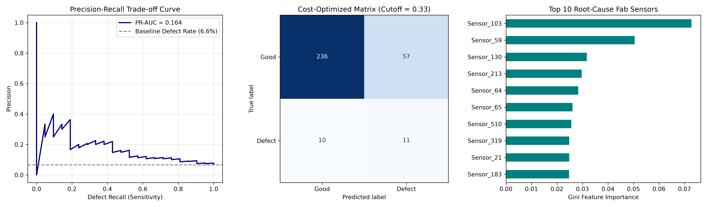

# Cost-Sensitive Semiconductor Wafer Yield & Root-Cause Optimization System

An industrial machine learning pipeline designed to maximize silicon wafer yield, minimize costly customer test escapes, and isolate root-cause fabrication sensor anomalies using the **UCI SECOM Semiconductor Dataset** (1,567 wafers, 590 physical sensors).



## Engineering Problem & Fab Economics
In semiconductor manufacturing, standard classification accuracy is misleading due to severe class imbalance (**93.36% baseline yield vs. 6.64% defect rate**). Furthermore, prediction errors carry asymmetric financial penalties:
* **False Negative (Test Escape):** Shipping a defective chip to a customer causes field failures and RMA costs (**10× penalty weight**).
* **False Positive (Overkill):** Flagging a good wafer for automated re-testing consumes minor Automated Test Equipment (ATE) capacity (**1× penalty weight**).

## Pipeline Architecture & Methodology
All preprocessing and feature selection steps are encapsulated inside a leak-free `Scikit-learn Pipeline`:
1. **Sensor Quality Audit:** Eliminated 32 unreliable sensors (>40% missing values) and removed zero-variance (dead) channels.
2. **Outlier-Resistant Preprocessing:** Applied **Median Imputation** (robust against transient fab equipment spikes) and `StandardScaler`.
3. **Statistical Dimensionality Reduction (One-Way ANOVA):** Used `SelectKBest(f_classif)` to filter 590 raw channels down to the top **60 statistically significant sensors** (`89.8%` reduction).
4. **Multi-Model Benchmarking & Tuning:** Evaluated Logistic Regression, Random Forest, and Gradient Boosting via 5-fold Stratified Cross-Validation, optimizing the champion Random Forest (`max_depth=8`, `n_estimators=200`, `min_samples_leaf=4`) with `GridSearchCV`.
5. **Cost-Sensitive Decision Thresholding:** Replaced the arbitrary `0.50` probability cutoff with a custom semiconductor penalty optimizer, mathematically calibrating the decision boundary to **`0.33`**.

## Key Results & Business Impact

| Metric | Default Cutoff (`0.50`) | Cost-Optimized Cutoff (`0.33`) | Impact |
| :--- | :---: | :---: | :--- |
| **Defective Wafers Caught (Recall)** | 4 / 21 (19.0%) | **11 / 21 (52.4%)** | **+175% increase** in defect detection |
| **Estimated Fab Penalty Cost** | 182 units | **157 units** | **-13.7% reduction** in test-escape penalty |
| **Test Set ROC-AUC** | — | **0.7118** | Strong separation across imbalanced classes |
| **Pipeline Execution Time** | — | **25.32 sec** | Efficient multi-core `GridSearchCV` |

* **Root-Cause Failure Analysis:** Gini feature importance isolated **`Sensor_103`**, **`Sensor_59`**, and **`Sensor_130`** as the primary sensor anomalies driving wafer defects.

## How to Run Locally
```bash
git clone https://github.com<your-username>/semiconductor-yield-cost-optimizer.git
cd semiconductor-yield-cost-optimizer
pip install -r requirements.txt
python secom_yield_optimizer.py
```

## Tech Stack
* **Languages & Libraries:** Python, Pandas, NumPy, Scikit-learn, Matplotlib
* **Statistical & ML Techniques:** Stratified K-Fold CV, One-Way ANOVA (`f_classif`), Cost-Benefit Threshold Optimization, Precision-Recall Analysis
